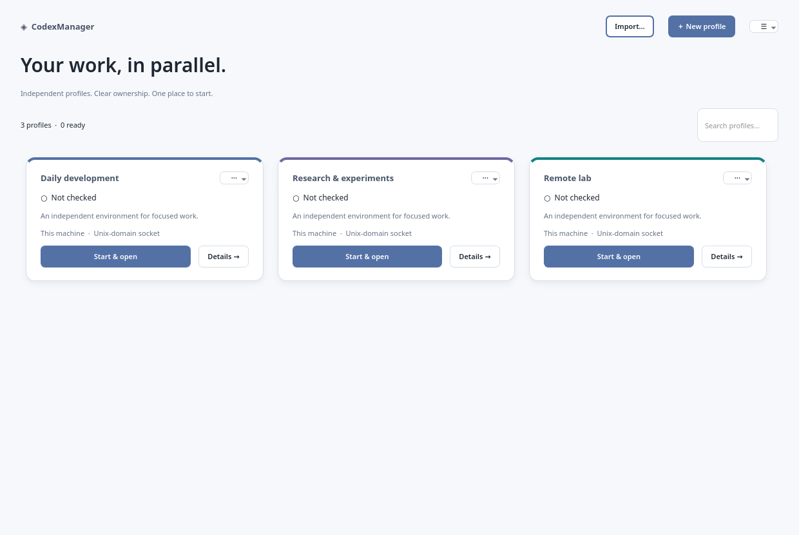
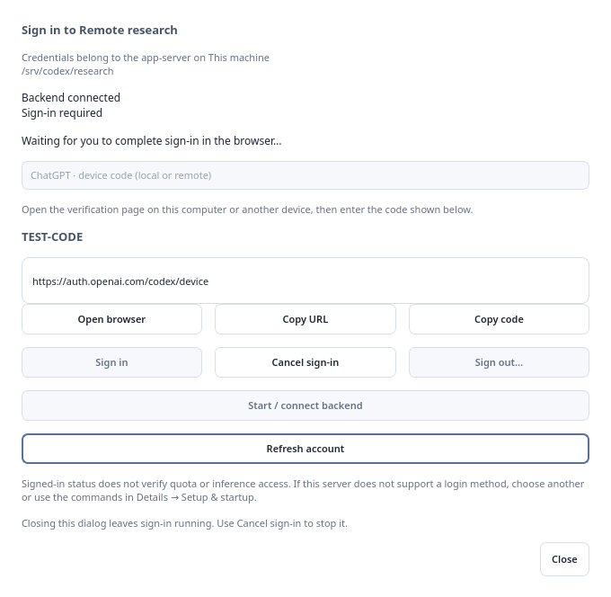

# CodexManager

CodexManager (`codex-manager`) manages independent Codex profiles and opens a separate native CodexUI process for each one. It is built and installed alongside `codex-ui`. Each profile has its own `CODEX_HOME`, endpoints, service identities, window title, accent and Qt settings. Conversations, projects, sections and inference remain owned by the existing app-server and CodexUI implementations.



[Qualification and implementation record](../qualification/codexmanager-2026-10-16.md), including validation limits and screenshot provenance.

## Start

Build `codex-manager` and `codex-ui` using the repository's normal CMake configuration, or install both through the normal install target. The manager requires Qt Widgets and Qt Network. Managed processes require Linux systemd user services and `flock`; remote management additionally requires the OpenSSH client. The existing AISuite `codex-bridge` and `codex-bridge-client`, and the selected Codex executable, must be available on their respective hosts. A source build of the manager prefers its sibling `codex-ui` when creating a profile.

```bash
codex-manager
```

Choose **New profile**, give it a name and choose its home and accent. Keep the defaults for a local bridge with a bridge-owned stdio app-server, or configure the two links independently in **Bridge** and **App-server**. Register an existing local home through **Choose an existing local Codex home**. Saving a registration does not create its home or copy authentication.

**Local tools** checks the configured UI and readiness client asynchronously and disables frontend transports absent from either executable. Before starting an inactive managed component, the manager asks that component to validate the generated configuration on its own host. Unsupported configurations fail before the managed launch. TLS certificate paths belong to the bridge host; the client CA path belongs to the manager/UI host. SNI selects the bridge server name; certificate-chain trust uses the existing transport implementation. SNI alone does not establish hostname verification. Configure valid IPv6 or Bluetooth addresses when choosing those transports. The current app-server provider supports stdio and Unix/IPv4/IPv6 WebSockets; its WebSocket path is `/`.

Use **Account / Sign in** on a profile card or its Details page to authenticate that profile. **Details → Setup & startup** also supplies host-specific fallback commands for browser login, device-code login, account status and logout. Starting a locally managed owner creates a missing home with owner-only permissions. The optional shared-instructions choice links an existing local `~/.codex/AGENTS.md` only when the profile has no existing `AGENTS.md`. Prepare remote directories on their host using the displayed commands; interactive manager authentication works through a reachable bridge regardless of process ownership.

**Start & open** checks the owners, starts missing managed components in dependency order, waits for bridge protocol/provider readiness, and reads the account state. A signed-out profile stays at setup so it can be authenticated first. Click **Open CodexUI** explicitly to browse without signing in; model requests require the appropriate credentials. **Show CodexUI** activates the profile's existing window. Each UI process retains its own event loop and existing session runtime. Readiness monitoring uses the existing bridge client as an observer and releases control before launching the UI.

## Sign in and account status



**Account / Sign in** shows the profile name, app-server host and exact `CODEX_HOME`. Start/connect the backend there if necessary, then choose one of these methods:

| Method | Local app-server | Remote app-server |
| --- | --- | --- |
| ChatGPT device code (default) | Open the verification page and enter the displayed code. | The same flow; the browser can run on the manager machine or another device. No callback tunnel is needed. |
| ChatGPT browser callback | Start sign-in and choose **Open browser**. | Copy the URL and open it on the app-server host, or arrange its localhost callback tunnel yourself. Device code avoids this requirement. |
| OpenAI API key | Enter the key in the masked field and choose **Sign in**. | The key is sent through the configured bridge to the remote app-server. Use a trusted, protected connection. |

The app-server performs and persists authentication. The manager does not copy auth files, export keys, or own OAuth refresh tokens. The key entry is cleared after submission. Login URLs and device codes stay in the active dialog/runtime and are not written to the manager's log or profile registry. External-token OAuth integrations that own and refresh tokens themselves are a separate app-server mode, not a manager credential store.

**Open browser**, **Copy URL**, **Copy code**, **Cancel sign-in**, **Refresh account** and confirmed **Sign out** are available in the dialog. Closing the dialog leaves its pending sign-in running; reopen it to continue or cancel. An unsuccessful or unsupported flow offers another method or the host-specific fallback commands. Device-code availability can depend on account/organization settings. Sign-out affects every client sharing that app-server home, not other independent homes.

The manager remains a bridge observer except while performing authentication. If CodexUI already owns control, choose **Release control** in CodexUI, perform authentication in the manager, then choose **Claim control** in CodexUI. Closing that UI window also releases its control. The manager never forcibly takes control, closes an active conversation, or changes the bridge's access policy.

Backend connection and account status are separate. A reported account means credentials are configured, not that quota, subscription access or inference has been verified. An explicit unauthorized inference notification displays **Authentication rejected**. Connection loss clears account certainty and active login details; reconnect and refresh to discover the authoritative outcome. No automatic login retry can switch accounts or replay an API key. Browser/device login completion is correlated by login ID, and request responses by connection-local request IDs. Other profiles retain independent runtimes and authentication state.

The implementation uses the app-server's existing [`account/read`, login, cancellation, logout and account notifications](https://learn.chatgpt.com/docs/app-server#authentication-modes) through the existing bridge client. It does not start another app-server for login. Account requests have a bounded response wait; an interactive login has a ten-minute manager deadline followed by cancellation when its login ID is known. If the connection or a request times out before an outcome is known, refresh account state instead of assuming success or logout.

## Ownership and remote hosts

| Ownership | Behavior |
| --- | --- |
| Managed locally | Uses a stable per-profile systemd user service on this machine. |
| Managed over SSH | Uses that host's systemd user service through noninteractive, host-key-verified SSH. |
| Started externally | Displays foreground startup/shutdown commands and observes readiness; never stops the external process. |

For stdio, the bridge owns its child app-server; the separate app-server ownership fields do not apply. For Unix providers, choose local, SSH or external ownership. Network app-servers must be started externally or explicitly managed over SSH, as required by the deployment policy. A Unix provider must share its host with the bridge. CodexUI cannot directly reach a remote Unix frontend; use a network frontend or configure a separately prepared tunnel as an external local endpoint.

A local bridge is manageable with every supported frontend transport. Bridge and app-server can run on different hosts and be managed independently over SSH. SSH authentication uses the configured alias, optional identity-file reference, agent and normal SSH configuration. Known host keys must already be verified; the manager never accepts unknown keys automatically. The remote account needs a working systemd user manager; for unattended services after logout, arrange its lifetime with the host administrator, for example through linger. The manager does not change host-wide service policy.

Lost SSH supervision means **status unknown**, even when a prior process was running. On reconnect the manager checks and adopts the same service instead of starting a second copy. Service description and identity are checked before adoption and shutdown. Do not edit or remove a profile while its owned processes are running or their status is unknown; restore supervision and stop them first.

## Lifetime and isolation

Owned units use `codexmanager-<profile-uuid>-{appserver,bridge,ui}.service`. Backend services persist independently of the manager or an SSH terminal. An owning launch holds a nonblocking lock in its effective `CODEX_HOME`, preventing two manager stores from launching that same managed environment. Registration validation rejects shared homes, duplicate Unix sockets and conflicting listener ports within the known profile inventory. Local home aliases are resolved when possible; distinct SSH aliases must consistently identify the same machine because the manager cannot prove that two arbitrary aliases refer to one host.

**Stop profile** stops only verified owned components in reverse dependency order. Systemd first sends its normal termination signal and escalates after the configured 15-second stop timeout. External components remain running. Closing CodexUI leaves its bridge running. Closing the manager window hides it to the tray, or minimizes it when a tray is unavailable. **Quit manager** leaves services and UI windows running. **Remove registration** never deletes a home, authentication or conversation history. To restart, stop the profile, then start it again.

Distinct homes separate Codex state; they are not filesystem security boundaries. Network access controls and TLS remain deployment responsibilities. Environment overrides support non-secret `KEY=value` entries. `CODEX_HOME` and UI identity variables come from the profile; secret-like variable names are rejected. Keep secret values in appropriate host-side credential stores. Known bearer/API token forms are redacted in displayed/exported service logs; arbitrary process output cannot be guaranteed secret-free.

## Storage and diagnostics

Profiles are stored as versioned JSON under Qt's `AppConfigLocation` for **CodexManager**, normally `~/.config/CodexManager/profiles.json`. Writes are atomic and owner-readable/writable; an invalid store is never silently replaced. Import/export copies configuration references, not home contents or credentials. `codex-manager --profiles /absolute/path/profiles.json` selects a different registry. A lock prevents two managers from writing the same registry concurrently.

Details contains **Overview**, **Configuration**, **Setup & startup**, and **Logs** tabs. Technical paths can be expanded. Logs support refresh from local/remote journals, filtering, paused updates, copy and export. The log buffer and helper-command output are bounded. Process running, connection state and protocol readiness are displayed separately; no conversation or inference counts are synthesized.

## Development qualification

The `codexmanager` CTest entry exercises profile storage, deployment commands, quoting, conflicts, independent service lifecycles, SSH loss/adoption, ownership refusal, failed/cancelled startup, native window identity/activation, installed bridge/client/UI command parsing, and actual manager widgets. Service/SSH fixtures are explicitly simulated. Its installed-configuration checks require AISuite's bridge/client executables on `PATH`; TLS fixture files validate option parsing only, not a TLS handshake.

Run through Xvfb with the offscreen Qt plugin. Repeat geometry cases at DPR 1.0, 1.25, 1.5 and 2.0. `CODEXMANAGER_EVIDENCE_DIR` selects a screenshot directory. The separate `liveLocalProfiles` test requires `CODEXMANAGER_LIVE_QUALIFICATION=1`; it creates disposable homes and uniquely named real systemd services, starts the actual bridge/app-server/UI for stdio and Unix providers, checks both windows' activation sockets, stops one while the other remains ready, and cleans up owned services. Run it explicitly against the rebuilt `codex-ui`; it does not authenticate or request inference. Live remote hosts, TLS handshakes and Bluetooth hardware need separate environment-specific qualification.

## Delete a profile

The profile card's action menu offers **Remove from manager…** (registration only) and **Delete profile and its data…** (permanent cleanup). The latter previews the exact home host/path and local manager-settings directory, checks ownership, requires an exclusive-use confirmation and the exact profile name, stops verified managed components, deletes the two directories, and removes the registration last. Closing the dialog after confirmation does not cancel cleanup; its progress remains on the card. Keep the manager running until cleanup completes. Failed cleanup retains the registration and explains that some files may already have been removed; resolve the error and retry.

New local homes created by the manager contain `.codexmanager-owner` with their profile UUID. Existing generated `.codex-<first-eight-UUID-characters>` homes are recognized as legacy homes, subject to explicit exclusive-use confirmation. Other pre-existing homes are registration-only by default. To opt a dedicated existing home into deletion, first establish that no other profile or application uses it, then create a regular, owner-only `.codexmanager-owner` file containing the exact profile UUID shown in its exported configuration. Do not mark a shared directory. The default `~/.codex`, your home directory and its ancestors remain protected even with a marker.

Full cleanup requires Python 3.11 or newer with safe directory-relative deletion and Linux `/proc` on the target host. It rejects symlinked target paths, overlapping registered homes, mounted subtrees, mismatched ownership, a held runtime lock, and visible same-user Codex/app-server processes using the home. Symlinks inside a deleted tree are removed without following their targets, preserving linked shared instructions. Keep SSH aliases consistent and confirm exclusive use across other registries and machines: the manager cannot prove that two different SSH aliases identify the same host. Unmanaged components must be stopped by their owner before deletion.

SSH profiles use the same guarded cleanup on their configured host. With no SSH target, the **Manual instructions** tab provides the exact commands to run on the actual app-server host and this machine; every command independently previews and confirms its target. Remove the registration after those commands succeed. The manager does not guess that an externally hosted home is local.

Deletion removes credentials stored inside the home, not OpenAI authorization grants or credentials in an external OS keyring. Use **Account / Sign in… → Sign out** first if that is also wanted. Source checkouts, external data reached through symlinks, socket locations, and system journals are outside the deletion scope. A failed partial deletion leaves an ownership marker for retry; local startup refuses a home marked as partially deleted.
