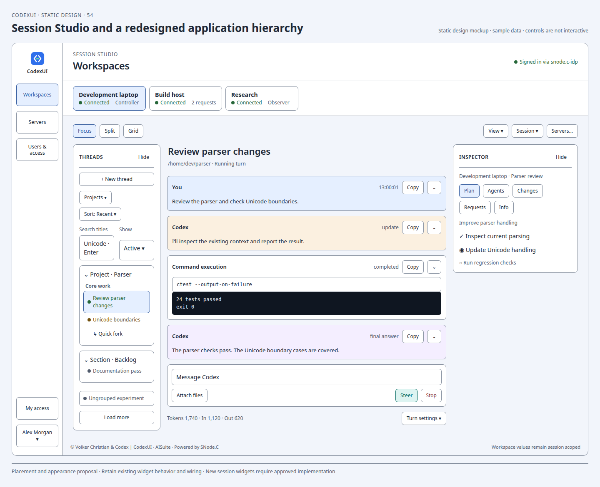
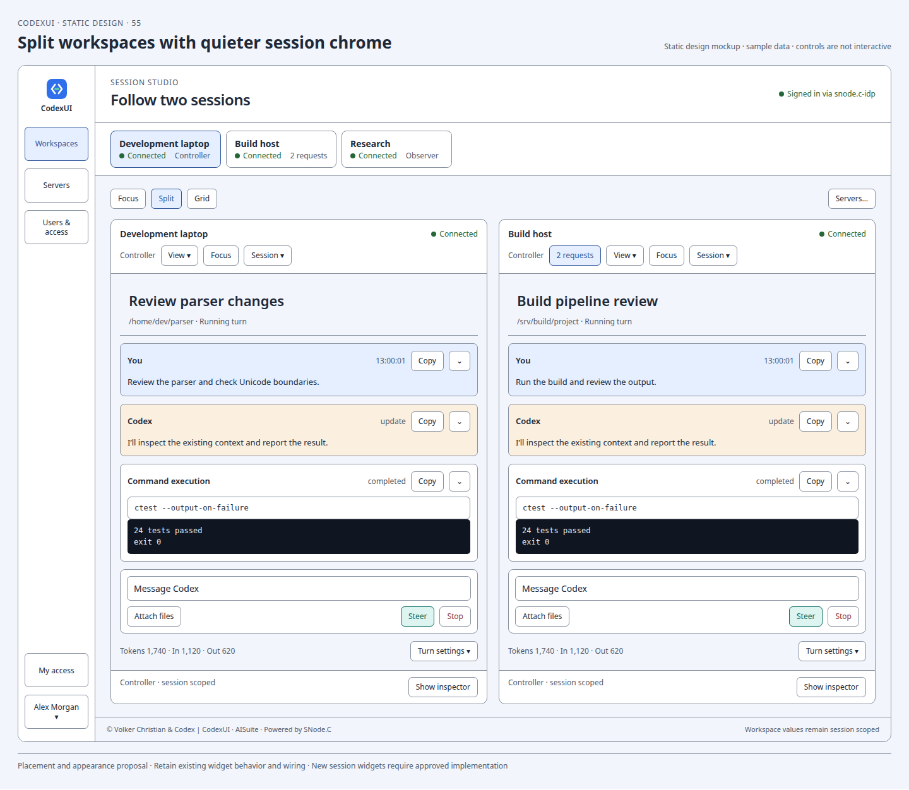
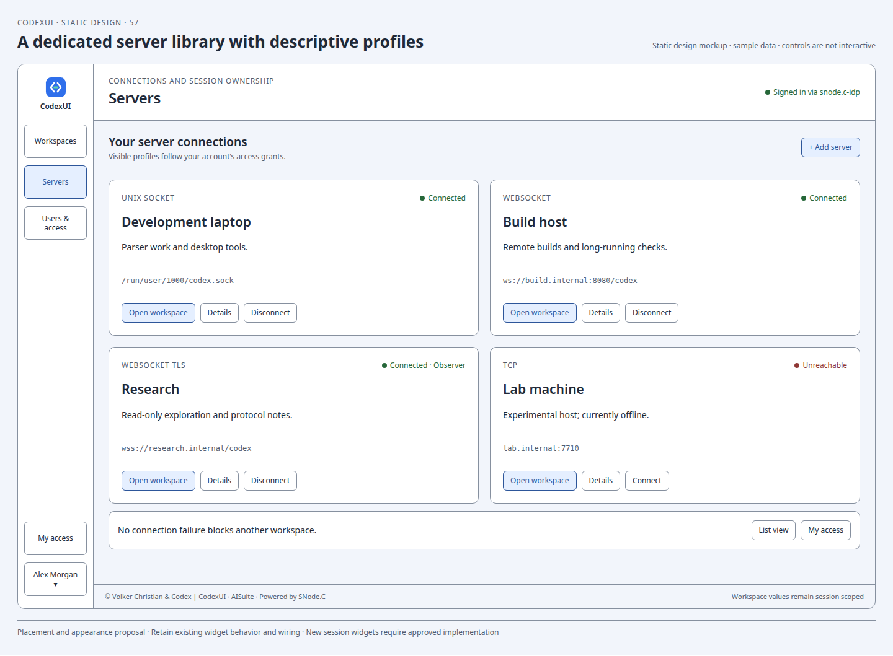
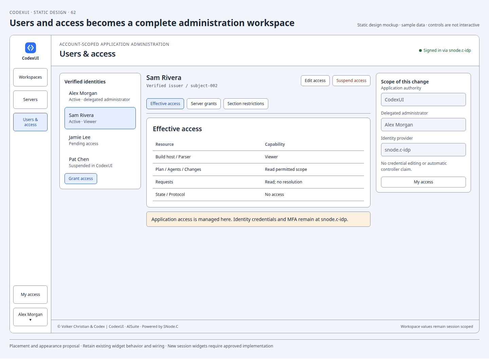
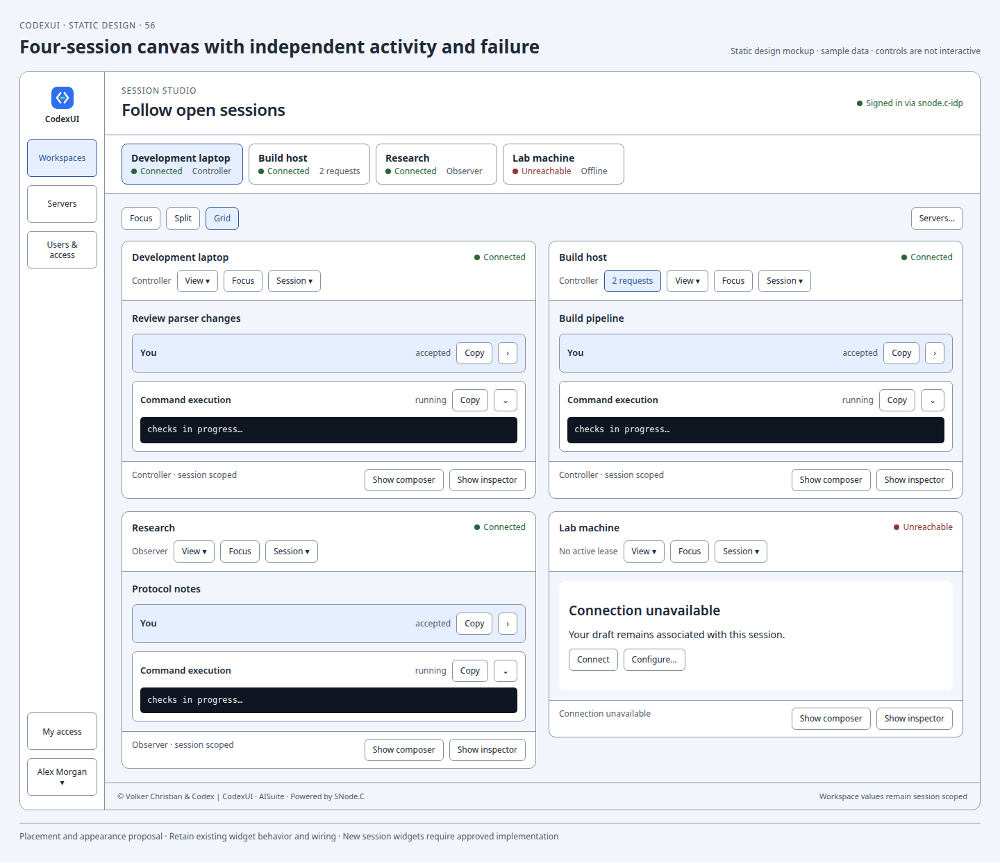
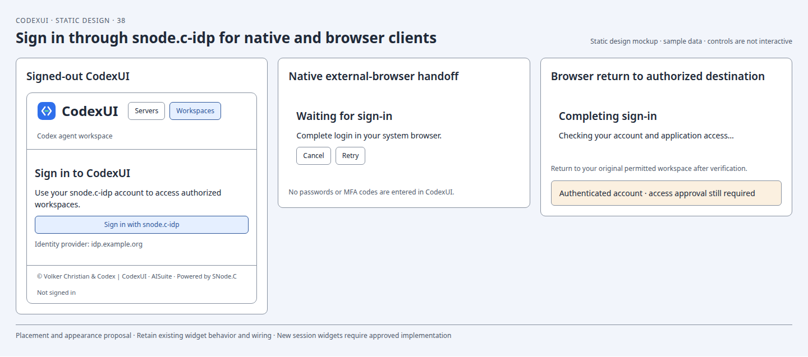
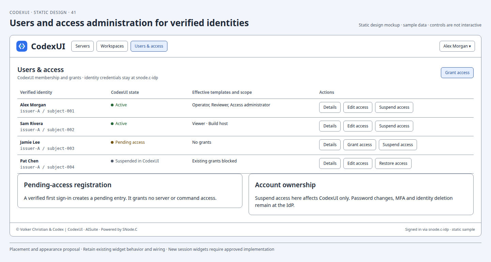
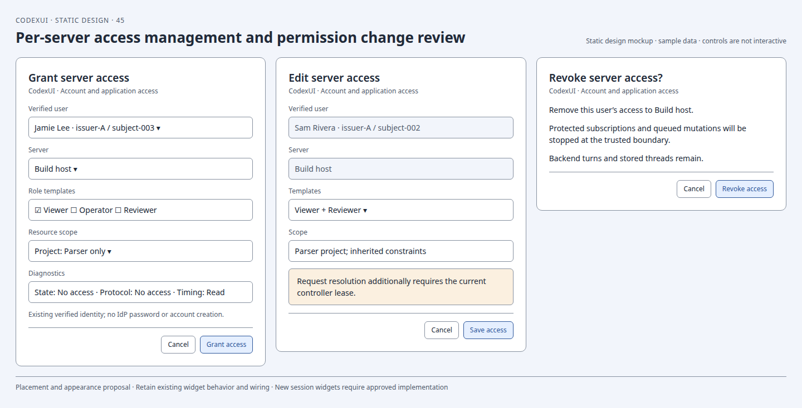

# CodexUI multiple server design proposal

Status: UI proposal for review. No production implementation or wiring change is included. The [static mockup appendix](mockups/README.md) covers all UI aspects in 66 fixed design sheets. These mockups contain no interactive behavior.

Use **Servers** for saved app-server connections and **Workspace** for the existing thread, conversation, composer and Inspector interface belonging to one server. This avoids confusing an app-server connection with a conversation thread, while leaving the existing internal `FrontendSession` name available. A saved server remains listed when disconnected or unreachable. Multiple servers may stay connected and multiple workspaces may be followed simultaneously.

## Governing invariant

Every operation, protocol identity, controller role, pending request, draft and presentation state belongs to exactly one server owner. Changing the visible server changes presentation only; it must never retarget an existing widget, callback, request, graph reference or in-flight operation. A failed server must not terminate the application or change another server's state. Identity and effective access belong to the verified human principal; UI visibility and controller ownership cannot substitute for authorization.

The current architecture is designed around one owner; it does not yet satisfy this proposed multi-server invariant. The proposal does not treat that as a widget defect or introduce a second protocol-state authority to work around it.

## Recommended direction: Session Studio

Rebuild the application hierarchy around three visible scopes: **application → server workspace → thread**. The proposed **Session Studio** gives each scope its own place: a global navigation rail, a dock of open sessions, and a workspace canvas. This changes navigation, spatial hierarchy, management pages and reading/review layouts together. Sheets **54–66** are the recommended whole-application design; sheets 01–53 remain detailed component/state references. Where their outer chrome differs, the Studio composition takes precedence.

### Navigation and spatial hierarchy

| Scope | Presentation | Purpose and ownership |
| --- | --- | --- |
| Application | Stable left rail: Workspaces, Servers, authorized Users & access; My access and account at the bottom | Move between work, saved connections and administration without mixing their controls |
| Open sessions | Dock of named tabs with explicit connection state, role/attention and endpoint disambiguation | Choose the active workspace; opening/closing a tab and connecting/disconnecting are separate actions |
| Workspace canvas | Focus, Split or Grid layout; View and owning-session controls | Arrange independently owned workspaces while retaining each widget's destination |
| Thread | Thread title/path, existing conversation and composer; Threads tray and Inspector | Read, submit, steer, stop and review using the current widgets and callbacks |

The rail is intentionally quiet. The selected session is the strongest navigation accent; the thread title leads the work area. Conversation cards retain their semantic colors, with compact controls and neutral surrounding surfaces. Server state, runtime role and pending requests remain textually distinct. No decorative per-server color scheme is introduced. Typography, spacing, borders and surfaces derive from the existing style authority; the proposal reorganizes their hierarchy rather than creating a second styling system.

The named account entry sits at the bottom of the desktop rail and moves into the header on narrow screens. It opens one account menu. Users & access appears only where the principal may discover it. Login becomes a dedicated identity gateway before private application metadata is rendered.

### Focus, Split and Grid

**Focus** gives one workspace the canvas. Its existing Threads pane occupies a left tray, the conversation takes the center, and the existing Inspector occupies the right. The initial desktop composition shows both side panes; users may hide either or both. A reading presentation retains the conversation and composer at a comfortable width with a persistent View entry. Expanding the Inspector for Changes/review shifts space within that owner's workspace; it does not create a global Inspector. Plan, Agents, Changes, Requests and Info keep their current meanings. Sheet 60 also shows the existing modeless DiffViewer alongside the workspace as a separate surface; embedding that viewer into Inspector would require separate wiring approval.

**Split** follows two selected open workspaces side by side. Each tile names its server and retains its own conversation, composer, role, request entry, View and session menu. Side panes start tucked away at smaller tile widths and can be restored at a usable size. Giving one tile Focus changes arrangement only. Choosing a tile does not redirect another tile's buttons or move its draft.

**Grid** follows three or more open workspaces. The four-session sheet includes a readable observer and an unreachable host alongside two active sessions. Compact tiles can collapse composer, settings and existing card disclosures; their labeled restore actions remain visible. Grid is a layout, not a new conversation-summary renderer. No four-session data-model limit is proposed: additional owners scroll in the canvas; a tab overflow list keeps every open owner reachable. Layout breakpoints and maximum practical visible density must be qualified with real widgets.

Changing layout preserves widget instance/owner identity, selected thread, independent drafts, Inspector selection, scroll position and follow-tail/user-detached reading state. A server workspace appears once in the canvas. Hidden owners continue their independent protocol processing. The existing bounded conversation renderer remains bounded; layout changes do not create passive duplicate renderers. Failure and recovery affect only the owning tile.

In Focus, the canvas-level View and Session menus refer to the **explicitly selected dock tab**, identified by name in the menu. Split/Grid use their individual tile menus instead of repeating those controls above the canvas. Hover does not select a command destination. Request counts open the owning existing Requests surface; token totals remain in their owning workspace, never an ambiguous application aggregate.

### Management deserves complete pages

**Servers** becomes a library of descriptive connection cards, with a compact list as an optional density presentation over the same profiles. Each card exposes name, user-facing purpose, transport, endpoint, explicit status and Open workspace. Connect/Disconnect, Configure and Remove remain individually scoped. Offline profiles stay visible. A dedicated detail page separates Overview, Connection and Access and embeds the owning existing connection settings surface; it does not create new transport semantics. Unsupported browser transports remain explained and unavailable.

**Users & access** becomes a full administration workspace: verified identities at the left, effective grants and resource restrictions in the center, delegation/authority context at the right. Grant/edit/revoke are reviewed in context. Identity credentials and MFA stay at snode.c-idp. This page uses the authorization ownership decision below; its richer layout does not imply an unsupported IdP administration API.

### Journeys and restoration

A normal journey is **IdP sign-in → authorized Servers library → Open workspace → Focus → Split/Grid when following other sessions → owned Inspector for review**. Returning to Servers or administration preserves open workspaces. Navigation and layout changes do not connect, claim control, submit, stop or resolve requests. The account menu provides My access and the IdP account handoff from every authorized page.

Use one **View** menu per visible workspace scope for Show threads, Show inspector, Show composer, Show settings, Restore all and Reveal all content. This replaces a permanent row of repeated restoration buttons in the earlier outer-shell studies. Hidden regions may additionally show a direct labeled restore affordance in their vacant slot. Narrow screens use the same hierarchy with compact navigation and an open-session list; Threads, Inspector and View open the same owned surfaces at readable width. Every pane has a visible return path. Authorization still governs restoration.

### Alternatives and design boundary

| Direction considered | Benefit | Cost / decision |
| --- | --- | --- |
| Earlier top-bar shell with repeated complete session chrome | Familiar and close to today's arrangement | Too much repeated navigation in simultaneous views; retain as component reference |
| Permanent server sidebar beside every work area | Fast access to many saved endpoints | Competes with global navigation and the existing Threads pane for width |
| **Session Studio: rail + open-session dock + canvas** | Separates app, connection and thread scopes; supports focused work and concurrent following | Recommended; requires reviewed presentation seams and new session-management surfaces |

The reuse boundary is **the original bound workspace owner and its existing widget/action identities**, including their single handler ownership. Moving or restyling presentation must preserve those identities, lifetimes and callbacks. Do not instantiate another shell over the same owner, retarget a live composer/Inspector, or create a second thread browser. Outer layout and visibility can change; splitting current shell responsibilities or exposing new layout seams needs implementation review. If a seam requires a real wiring change, present it for explicit approval before coding.

This proposal adds substantial new session/navigation/access presentation, so it cannot be implemented as a neutral-LOC cosmetic patch. Reduction comes first: remove redundant per-session application chrome, reuse existing controls, and consolidate restore entry points. The remaining additions must be estimated in the later implementation plan, with obsolete chrome/state removed in the same approved stage. No production additions are made here.

## Static mockup appendix

The [complete visual appendix](mockups/README.md) contains 66 noninteractive design sheets and a coverage index. The [static atlas](mockups/index.html) presents the same sheets without scripts, editable controls or animations. Existing widget mockups depict their retained control anatomy and semantics; new server-management widgets are marked by their session-specific context.

| Area | Sheets |
| --- | --- |
| Recommended Session Studio whole-application composition and journeys | 54–66 |
| Earlier shell studies and detailed simultaneous-session states | 01–03 |
| Server management, transports, failures and roles | 04–09 |
| Full restoration of hidden or collapsed widgets | 10 |
| Thread browsing, groups, lifecycle and all related dialogs | 11–16 |
| Every conversation content family, composer, settings and attachments | 17–21 |
| Every Inspector view, approval/input dialog and shared chrome surface | 22–29, 37 |
| Acceptance/inference storyboards, perceptual colors, borders and responsive states | 30–36 |
| IdP login/account handoff, user management and access policy for every section | 38–53 |

The remaining sheets appear in the [complete visual appendix](mockups/README.md), including every dialog and every card family. Animation frames are deliberately static. Acceptance by OpenAI and inference-start facts are not inferred from these sample states.

## Login and user access management

All application sections require an authenticated identity and an explicit effective access decision. This covers both application pages/panes and the Projects/Sections/thread organization inside each server. Login must use the user's snodec-idp project, located at [SNodeC/snode.c-idp](https://github.com/SNodeC/snode.c-idp), forked from jan-eberwein/auth. CodexUI must not implement a second password database, password form, MFA verifier or account-recovery service.

The requested access controls are an explicit extension to the earlier behavior-preservation boundary. Existing widgets and authorized action callbacks remain reusable; authentication, read filtering, permission checks and permission-driven disabled/locked states are new functionality and wiring that require an approved implementation plan. No production authentication or authorization is implemented by this proposal.

### Verified IdP capability and ownership decision

Source review covers snode.c-idp commit `ea1e02de005d0919701f37292dbf7c74101f0fd9`. The source routes and active SQLite initialization are the evidence boundary; older README endpoint names and the separate MySQL schema file are not treated as the running contract. Login/token endpoints in this revision use `/oauth2/authorize` and `/oauth2/token`; configuration must be derived from the actual deployed contract, not hard-coded from the older README.

| Capability | Inspected support | Proposed owner |
| --- | --- | --- |
| Login, authorization code and S256 PKCE, signed access token, verification, discovery/JWKS | Present in the IdP/client sources | snode.c-idp and its existing snodec-auth client package |
| MFA, registration, profile/password changes, reset and self-service account deletion | Present in IdP routes; deployed options still govern availability | IdP-hosted pages; CodexUI links to them |
| Human identity attributes and stable token subject | Subject, issuer, audience, username/email and MFA fact are available | IdP owns identity; CodexUI uses `(issuer, subject)` as its identity key |
| Administrator user directory, managed groups, role assignments and resource/action grants | No such administration routes or policy tables found in the inspected source | CodexUI application-access administration |
| Access decisions for specific servers, projects, shared sections, threads and Inspector panes | No corresponding permission model found | One CodexUI authorization authority at the trusted application service/bridge boundary |
| Immediate application-access revocation and ongoing stream filtering | Not established by token verification alone | CodexUI authority and the trusted enforcement point |

The reviewed token issuance copies the request's `scope` string into signed claims; `UserContext::hasScope()` only tests for a matching string. Neither establishes that an administrator granted that scope. Do not interpret a caller-requested scope such as `codexui.admin` as authority, and do not infer application administrator status from a first-account/setup caption. [Token issuance and routes](https://github.com/SNodeC/snode.c-idp/blob/ea1e02de005d0919701f37292dbf7c74101f0fd9/src/apps/auth_idp/IdpServer.cpp), [identity context](https://github.com/SNodeC/snode.c-idp/blob/ea1e02de005d0919701f37292dbf7c74101f0fd9/src/auth/UserContext.h), [active SQLite schema](https://github.com/SNodeC/snode.c-idp/blob/ea1e02de005d0919701f37292dbf7c74101f0fd9/src/database/sqlite/SqliteDatabase.cpp).

**Decision for this revision: IdP owns authentication and credential/account self-service; CodexUI owns who may access which application resources and perform which actions.** CodexUI's user list is a list of verified identities enrolled in this application, not a duplicate of the IdP's password-bearing account directory. Suspending a user here suspends CodexUI access only; deleting an identity or changing its credentials stays with the IdP. Add existing users by a verified issuer/subject association, not by assuming that an email address alone proves identity. A first verified sign-in can create a Pending access entry, without granting access automatically.

If a later snode.c-idp revision supplies administrator-managed, resource-scoped permissions, adopt it only after verifying assignment authority, server-side enforcement, principal/resource/action semantics, audience isolation, policy revision and revocation behavior. Then replace the CodexUI policy store with that authority in one approved migration. Do not operate two editable policy stores or silently combine IdP scope strings with local grants.

### Sign-in and account experience

The signed-out application shows **Sign in with snode.c-idp**, the configured identity-provider name/domain and a purposeful empty shell. Server endpoints, thread titles, request counts and cached diagnostics remain private until access is established. Native login opens the external system browser; the CodexUI window shows Waiting for sign-in, Cancel and Retry. The browser frontend redirects to the IdP and returns to its original authorized destination. Credentials, MFA and recovery are entered on an IdP-owned page, not inside a CodexUI webview. The native external-browser/PKCE design follows [OAuth for Native Apps, RFC 8252](https://www.rfc-editor.org/rfc/rfc8252); callback and token handling must be qualified against [OAuth Security Best Current Practice, RFC 9700](https://www.rfc-editor.org/rfc/rfc9700).

An authenticated chrome menu shows the human account, **My access**, **Account settings at snode.c-idp**, **Switch account** and **Sign out of CodexUI**. Access administrators also see **Users & access**. The same authenticated principal applies to all visible workspaces; runtime controller/observer labels remain on their own server panels. Signing into the IdP or successfully completing MFA does not automatically claim a controller lease or authorize a CodexUI command.

Registration, MFA enrollment, password reset and account editing reuse the IdP's existing pages where enabled. The corresponding mockups show the handoff and representative IdP fields; they do not propose replacing the IdP's interface. The deployed IdP URL remains configurable; the example `idp.example.org` domain in the sheets is sample data, not a change to the project's deployment.

A failed login, cancelled callback, expired login or unavailable IdP shows an inline retry/sign-in state. There is no local-password bypass. Existing application access may continue only while the trusted authority validates its current identity and grants; expiry or an unavailable required decision blocks protected reads/actions. Native secrets require an OS-protected credential path; browser deployment should use a server-owned session rather than readable token storage. The inspected callback helper performs a browser-side token exchange and sets a script-readable access-token cookie, so it cannot be adopted unchanged as proof of a completed protected browser session. This is an integration change to review, not permission to fork a second authentication implementation. [Existing callback helper](https://github.com/SNodeC/snode.c-idp/blob/ea1e02de005d0919701f37292dbf7c74101f0fd9/src/auth/OAuth2CallbackHandler.h).

### Administration pages and role templates

**Users & access** is a new administrator-only application destination. Its user list shows verified identity, CodexUI access state, role templates and resource scope. States are Pending access, Active and Suspended in CodexUI. User details provide an effective-access summary, server grants, project/section/thread restrictions and delegation boundaries. Administrators can grant access, change permitted roles/scopes and revoke access; they cannot edit passwords or manufacture IdP account states. Account identity fields are read-only projections from the verified IdP identity.

Use a small set of proposed role templates that expand into explicit capability grants. Templates are presets over one permission model, not a second source of runtime policy. Resource restrictions may reduce a template's capabilities. No user or worker becomes an application administrator merely because it connected first or currently controls an app-server.

| Template | Intended capability | Excluded automatic power |
| --- | --- | --- |
| Viewer | Browse/read permitted threads, conversation and ordinary Inspector views; Copy where the source content is readable | Submit, steer, stop, approvals, connection configuration or access administration |
| Operator | Viewer plus authorized thread/turn mutations, upcoming-turn settings and permitted attachments | Resolve approvals, change server connection configuration, inspect restricted diagnostics or grant users access |
| Reviewer | Viewer plus resolve supported approval/input requests in the granted resource scope | Submit/steer/stop or change access policy merely by being a reviewer |
| Server manager | Manage granted server profiles, connection configuration and permitted operational administration | Read every conversation, execute tools or edit application-wide user access by implication |
| Access administrator | Administer application access within explicit delegation boundaries | Automatic content access, controller ownership or tool execution; cannot grant beyond delegated scope |

Templates may be combined through one authority. Grants are additive capabilities within an explicitly permitted server scope, then constrained by resource and section restrictions. Unassigned users have no application access. A protected, preconfigured verified administrator identity bootstraps access management; being the IdP's first registrant is not a bootstrap rule for CodexUI. Prevent a sole administrator from accidentally removing the last delegated administration path without a reviewed transfer.

### Access rules across every section

| Application/resource surface | Read or visibility gate | Separate action gate |
| --- | --- | --- |
| Servers page and workspace tabs | Read permitted server profile metadata; no disclosure of denied endpoint/name/counts | Add/manage profiles, change settings or connect where server scope permits; local disconnect/close remains available for cleanup |
| Projects, Sections, Ungrouped and thread hierarchy | List/read only authorized groups and threads, including ancestor/path metadata and search results | Create/edit/delete/reorder groups; assign memberships; new thread, rename/fork/archive/delete independently governed |
| Conversation and every card family | Read the owning thread and any separately restricted content; protect image/file locations, Markdown links and Copy | Existing fold/presentation actions apply to readable content; recover/submit/steer/stop require their mutation grants |
| Composer, attachments and all turn settings | Restore/read only settings and draft belonging to the verified principal and authorized destination | Submit/steer/stop, attachment admission and setting mutation require Operator capabilities plus existing runtime requirements |
| Inspector Plan and Agents | Read permitted plan/agent facts; child threads independently checked | Copy/disclosure preserve the same read boundary; opening a child requires its own resource access |
| Inspector Changes and diff review | Read authorized repository/change scope, paths, hunks and related files | Copy, native file open and expanded review cannot reveal a resource denied by the read policy |
| Inspector Requests and composer attention | Read authorized pending-request facts and counts | Review and resolve capabilities remain distinct; resolve also requires the existing controller/current-request checks |
| Inspector Info State, Protocol and Timing | Each diagnostic section has an explicit grant; apply filtering before projection | Copy/export/details follow the same diagnostic grant, not just general thread visibility |
| Status, token details, notices, tooltips and background attention | Project only accessible resource metadata, counts and reasons | Jump/reveal opens only an authorized owning workspace; no hidden-session data leak |
| Profile/new-thread/group/file/request dialogs and menus | Same owning principal, resource and section as their entry point | Recheck the action at submission; stale dialog state cannot retain authority |
| Users & access and permission dialogs | Delegated user/access-management read grant | Grant/edit/revoke within delegation scope; policy changes are checked atomically |
| My access and IdP account handoff | Signed-in user sees their own effective access and their own IdP account entry point | Account editing/MFA/password flows stay at IdP; My access cannot grant authority |

A normal UI hide/collapse is different from **no permission**. Show pane, Restore all, Reveal content, menus, hotkeys, Copy, direct navigation and alternate layouts restore every authorized widget, but cannot bypass a denied permission. Restricted surfaces show a concise Access not granted explanation only where even that resource's existence is authorized; otherwise omit it without revealing its title or counts. A readable pane may remain visible with mutation controls disabled and a My access explanation.

Resource policy follows the actual graph, not a fabricated project/section nesting. Server access is a prerequisite. Project restrictions, shared-section restrictions and any thread restrictions are independent constraints; a thread in a shared section cannot become visible in a denied project merely because that section is readable elsewhere. Inheritance is explicit: missing narrowing entries inherit the server grant, while No access restricts it. Effective access is the intersection of the applicable resource constraints and the specific capability. Moving a thread between groups recomputes access before it is listed, streamed or acted on. A blank dropdown entry or hidden UI row is never treated as an allow.

### Trusted enforcement and session isolation

A Qt/browser window is not an authorization boundary. A CodexUI-owned trusted application service provides the canonical application grant store and decision policy; the bridge/resource endpoint enforces it before returning data, starting a subscription, accepting a controller claim or executing an operation. Every transport must reach that enforcement point. An unprotected raw TCP/Unix route that bypasses identity/access checks would violate the proposal. Enforcement changes in AISuite/SNode.C bridge integration require approval as well as CodexUI UI work; hiding buttons in CodexUI alone cannot enforce who has access.

Each session retains its dedicated master/SNode.C worker. Its authenticated connection is bound to the verified principal and policy revision, with server/thread/turn/request identity retained. Permission lookup and authentication refresh must not create a blocking shared session-processing thread. Publish bounded immutable access projections to the UI; do not copy the canonical policy into competing per-widget/per-worker ACL stores. Protected reads and commands are checked at the trusted boundary, including current policy/identity when queued work is actually executed.

The existing controller/observer role is a connection lease, not the human's security role. A mutation requires application permission AND its existing controller/provider readiness rules. An authorized Operator observing a server can read but cannot Send until the existing controller requirement is satisfied. An unauthorized user holding an old controller lease cannot mutate. A Reviewer cannot bypass the lease requirement for resolving a request. LLM tool approvals and sandbox policies remain separate from human application access.

Revocation or suspension removes protected subscriptions, blocks queued-but-not-executed mutations and invalidates open dialogs at the enforcement boundary. The affected UI clears newly inaccessible metadata and shows an access-change notice without exposing hidden resources. Sign-out/switch-account detaches frontend controller/transport references and separates all per-user drafts, local profiles, view state and permission projections; no old identity's content or draft is revealed to the next user. Sensitive drafts are recoverable only by the same reauthorized identity under an explicitly defined local retention policy. Sign-out or access removal does not issue Stop turn, delete threads or shut down an app-server automatically.

Personal profile persistence must now be namespaced by verified issuer/subject. Shared server profiles and permission bindings belong to the trusted CodexUI service, not client-local editable storage. Existing thread protocol data remains authoritative in its session graph/presentation contract; filtered authorized projections are not a new protocol-state authority. Direct disk/git/file-open paths in the native frontend also require authorized resource scope; a trusted client-side check cannot substitute for protection of the underlying filesystem/service against other processes.

### Login and access mockups

Sheets 38–53 in the [static appendix](mockups/README.md#login-account-and-user-access-management) cover login and IdP handoff, account menus, the verified-user list, effective access, role templates, the all-sections matrix, grants/revocation, shared-section constraints, denied/read-only views, controller/access distinctions, sign-out/expiry, login failures, authority ownership, narrow presentation and delegated-administration safeguards.

### Access integration approval and qualification

The necessary production additions are one authenticated-principal boundary, one application policy authority/store for the inspected IdP gap, trusted enforcement integration, user/access administration surfaces and lifecycle revocation handling. Existing identity/credential functionality is reused. Every widget consumes the same effective-access projection and keeps its existing authorized-action callback. This is a new access-management feature, not a neutral-LOC UI relocation; the later implementation plan must quantify growth, retire existing role-only assumptions and obtain the required approval before coding.

Qualification must cover signed-out direct links and data reads; forged/caller-chosen privilege scopes; invalid issuer/audience/expired identity; pending users and first-user bootstrap; controller-role/access-role combinations; every section and alternate reveal path; two users with the same display/email but different subjects; cross-server ID collisions; shared sections across projects; project/section/thread moves; queue-time revocation; active stream filtering; open approval dialogs during suspension; local file/Copy/tooltips/diagnostics leaks; account switching with drafts; IdP unavailability and callback failure; and independent worker responsiveness during authentication/access updates. The mockups illustrate these states without creating real IdP accounts, changing access grants or contacting the live provider.

## Visibility and restoration

Every hidden or collapsed authorized widget must be recoverable through a visible, keyboard-accessible interaction. Permission-denied content follows the access policy and cannot be revealed by restoration controls. Hidden widgets keep their existing ownership and state. Hiding is not destruction, disconnecting, resetting or cancelling work.

| Surface | How it becomes less visible | How it becomes fully visible |
| --- | --- | --- |
| Whole server workspace | Navigate to Servers or another tab | Workspaces navigation and the owning dock tab; Split/Grid reveals selected open owners, including unavailable ones |
| Threads pane | Existing Hide action or compact Split/Grid layout | Always-available View → Show threads in the owning workspace |
| Inspector | Existing Hide action or compact Split/Grid layout | Always-available View → Show inspector; request and timing entry points also reveal their existing target |
| Composer and settings region | Optional presentation-only collapse of its containing region | View → Show composer or the labeled tile action; Restore all also expands it |
| Upcoming-turn settings container | Compact Split/Grid layout | View → Show settings; Restore all expands the settings without changing their values |
| Secondary turn settings | Existing Additional/More menu | The existing menu opens all supported settings without replacing their inputs |
| Conversation content filtered by an existing preference | Existing reasoning/update visibility control | Existing preference plus the new Reveal all content action, which sets only those established visibility preferences |
| Turn/card, nested command output and agent disclosure | Existing disclosure | Existing disclosure at the retained title; Reveal all content expands currently loaded disclosures through their existing controllers |
| Project, section or thread hierarchy | Existing group disclosure | Existing disclosure at its retained heading |
| Inspector tab and Info detail | Another tab or detail selection | Existing tab, Info choice and Back controls; show Inspector first if needed |
| Narrow-layout pane | Responsive presentation | Labeled Threads/Inspector actions reveal the same pane; returning to Workspace does not lose its state |

The new **View** controls provide **Restore all** and **Reveal all content**. Restore all reveals Threads, Inspector, composer and all settings; Reveal all content restores filtered/collapsed loaded conversation content. Neither sends protocol commands, expands history beyond the currently loaded window, resets filters, edits settings, or changes the selected thread. Split keeps the conversation and composer visible; compact Grid may tuck the composer away behind its labeled Show composer action. Both preserve existing fold preferences and restore every region through View. Where these controls use an existing action, use that action rather than adding a parallel visibility controller. Container visibility without an existing action is a new presentation-only mechanism to be reviewed before implementation.

Full visibility means the widget is restored at a usable size, with its complete content reachable through its existing scrolling, disclosure and menu interactions. At narrow widths, side panes can use the supported drawer/page presentation rather than compressing all three panes into unreadable columns. Pane return actions remain visible, focus returns to the initiating control, and the active server identity is never hidden. The mockup stacks restored panes at narrow widths so their content can be inspected without horizontal clipping.

## New server widgets

| Widget | Content and interaction |
| --- | --- |
| Open-session dock and workspace canvas | Name, status and endpoint qualifier; switching changes visibility/focus; Focus/Split/Grid arranges independent open owners |
| Server library card / compact list row | Name, human description, transport, endpoint, explicit state, Open workspace, Connect/Disconnect and Edit |
| Server details | Full endpoint and plain-text description; connection status and last supplied diagnostic |
| Add server form | Name, description and transport settings; save the profile disconnected; connecting is an explicit separate action |
| Edit server form | Name and description can change without reconnecting; changing an endpoint is a distinct connection-settings workflow |
| Remove server confirmation | Names the profile; explains that removing it disconnects this frontend and does not delete backend threads or stop the app-server |
| Unreachable state | Inline reason and retry/connect action within that server's page; other servers remain usable |
| Visibility controls | Show threads, Show inspector, Show composer, Show settings, Restore all and Reveal all content, with clear current states |

Descriptions are local human-readable metadata. They must never enter prompts, thread base/developer instructions, system messages, protocol initialization metadata or tool input. Render them as plain text. Persist profiles locally using one profile store with stable opaque profile IDs; names and endpoints are editable attributes, not identity keys. Runtime connectivity is projected from the session owner, not persisted as a second connection-state authority. Two profiles must not accidentally overwrite each other's preferences when endpoints match.

Profile creation and metadata save are deliberately separate from the current native **Apply and connect** behavior. Keep the current connection dialog and its validation intact for a live connection. Do not silently relabel its Apply and connect button as Save. A disconnected profile editor needs an explicitly approved profile-storage path and can use the established field appearance without pretending that it is an unchanged dialog. For a live endpoint change, retain the dialog's existing reconnect semantics and explain the impact before application. Transport editing must preserve all effective settings, including optional TLS/RFCOMM configuration, rather than reconstructing them from only visible fields.

## Connection and failure states

| State | Meaning | Available server-management interaction |
| --- | --- | --- |
| Disconnected | Saved profile; no requested live connection | Connect, edit, remove, open workspace |
| Connecting | An attempt is underway | Disconnect/cancel using the existing disconnect operation; edit metadata; open workspace |
| Connected | Frontend transport connected | Disconnect; open workspace; existing per-server connection configuration |
| Unreachable | An attempted connection failed or a live transport was lost | Show the supplied reason; retry via existing Connect/Reconnect; edit or remove the profile |
| Provider unavailable | Frontend transport connected, app-server provider not ready | Preserve the connection; show provider detail and existing action eligibility |
| Unsupported transport | This frontend/build cannot connect this profile | Explain the capability; permit profile edit/removal and workspace inspection |

Controller/observer role and provider readiness stay separate from transport connectivity. A connected socket is not proof that the app-server is ready. Never invent a last-seen timestamp, successful retry, role, cached history or request count. Reuse the existing retry policy; do not add polling, a health-check endpoint, a watchdog or an automatic-reconnect preference as part of this UI proposal.

Loss of connectivity preserves unsent input and isolates action eligibility to the affected owner. Keep already retained content only where the authoritative lifecycle permits it; show stale/unavailable labeling, and do not promise offline history persistence. A server that never connected shows a purposeful empty workspace. No silent failover sends a prompt to another server. No modal steals focus when a background server becomes unreachable. A worker/runtime stop updates its owning server's status rather than calling application quit; application shutdown is the only global stop operation.

Removing a connected profile asks for confirmation after naming any locally known pending work/draft. It releases this frontend connection and its UI references in the required retirement order. It does not issue thread deletion, app-server shutdown or Stop turn. Cancelling removal preserves the profile and draft. Endpoint changes preserve existing generation retirement; late results cannot affect a new endpoint or another profile.

## Existing widget and wiring crosswalk

| Existing surface | Proposed placement | Wiring retained |
| --- | --- | --- |
| Native `ShellWidget` | Per-server Workspace, inside application navigation | Its original `FrontendSession &`, adapter, graph notification and diagnostic handlers |
| Native `MiddleRegionWidget` | Owned canvas body with reviewed Focus/Split/Grid presentation seams | Threads, conversation, composer, Inspector and their original coordination |
| Native `ThreadPane` | Owned Threads tray or restored narrow surface | Its existing `Actions`: selection, history/page/group browsing, rename, fork, archive, delete, timing, new thread and group management |
| Native `ConversationView` / `ConversationCard` | Workspace center | Existing projection, materialization acknowledgement, prompt recovery, Copy, disclosure, timestamps, history and follow-tail ownership |
| Native `ComposerPane` / `TurnSettingsWidget` | Workspace below conversation | Existing submit/steer, stop, attachments, approval entry points and upcoming-turn setting policy |
| Native `InspectorPane` | Owned right tray, expanded review area or restored narrow surface | Existing Plan, Agents, Changes, Requests, State, Protocol, Timing, pending-request actions and refresh |
| Native `ConnectionDialog` | Existing connection menu in the owning workspace | Same settings input, `selection()` payload, validation, modal result and ConfigureConnection action |
| Native `NewThreadDialog`, `PendingRequestDialog`, `FileSelectionDialog`, `DiffViewer` | Open from their original owning workspace | Same parent/lifetime, targets, inputs and callbacks; no cross-server rebinding |
| Browser `App({session})` | Per-server Workspace | Same session prop and subtree identity for its lifetime; existing ThreadPane, Conversation, Composer, Inspector and dialogs |
| Browser connection control | Original owning workspace | Same `connect(url)`, `disconnect()` and controller actions; WebSocket capability retained |
| Brand, notices, token details and attribution | Existing shell or new outer chrome as appropriate | Preserve original semantics and callbacks; do not aggregate session-specific values |

All supported native widgets and workflows remain available. The browser retains its documented scope: its frontend transport is WebSocket; raw TCP, Unix, native attachments and native local Git diff workflows cannot be promised by a layout redesign. In the browser, unsupported profiles display a capability explanation rather than a simulated Connect button. A bridge/proxy that enables raw TCP or Unix in a browser would be a separate approved feature.

No redesign of existing conversation cards, Markdown, Copy/disclosure primitives, turn settings, attachment surfaces or approval dialogs is proposed. The static mockups use representative visual stand-ins to explain placement; these are not a replacement production renderer or a claim that HTML stand-ins preserve native wiring.

## Perceptual color system

Color changes are permitted as part of this design, while widget structure and wiring remain governed by the reuse rules. Define semantic roles in a perceptual color space, using OKLCH as the proposal notation. Comparable status foregrounds use a common lightness/chroma range with distinct hues; comparable tinted surfaces use another common range. Light and dark appearance have separately tuned tokens. Hue alone must never carry status: retain explicit text and existing icons/indicators.

Keep user prompts blue, interim Codex updates amber, final answers violet, and success/failure states green/red unless a separate semantic change is approved. Use quiet neutral page surfaces, one blue selection role, and restrained state color. A server does not receive its own decorative color identity. Native colors must come from the existing UiStyle authority and browser colors from its established semantic token definitions; convert the proposed perceptual values to the target's supported color representation once at that boundary, including gamut mapping where needed.

Equal OKLCH lightness/chroma is a starting point, not proof of equal perceived prominence or accessible contrast. Check actual rendered foreground/background pairs, disabled and focused states, both appearances and color-vision alternatives. Tune a semantic token once rather than patching individual controls. Require at least 4.5:1 contrast for normal text and 3:1 for meaningful control boundaries/status graphics where applicable; use the existing accessibility model. The static mockups illustrate this palette; it is not a completed production color qualification.

## Architectural evidence and approval boundaries

The inspected path is native `main.cpp` → `FrontendSession` → `runClientRuntime` / `WorkerLogic` → `NodeGraph` → `NodeGraphUiAdapter` → `ShellWidget` → `MiddleRegionWidget` and its existing action callbacks back through typed channels. `FrontendSession` owns one graph, channel pair and worker. `ShellWidget::Impl` installs one graph-change handler and one diagnostic handler on that owner. Creating a second shell over the same owner would overwrite those handlers. Native `main.cpp` currently maps runtime stop to `application.quit()`. `ClientRuntime.cpp` starts/stops `core::SNodeC`; safe multiple loop ownership is not established by this UI inspection.

The browser path is `main.tsx` → one `BrowserFrontendSession` → SDK connection/transport and normalizer → `PresentationModel` / prompt coordinator / viewport state → `App` and its existing children. The session owns selected-thread and protocol-related mechanics, while composer text, inspection selection and pane visibility also live in React component state. Swapping a `session` prop or unmounting/recreating App would therefore not preserve all user state. Browser storage currently includes a global last bridge URL and endpoint-keyed browsing preferences; those need a reviewed profile identity policy for multiple servers. Native presentation preferences use existing QSettings keys; global display preferences should stay global unless an explicit per-server policy is approved.

Each session must have its own dedicated runtime worker/master thread, graph, SDK connection, typed mailboxes and protocol reduction path. A shared worker that processes every server is excluded by the user's requirement. A lifecycle container may own session handles and local profile metadata, but must not become a shared protocol-processing thread or serialize independent sessions behind one worker.

The current native FrontendSession already owns one dedicated clientThread. The inspected SNode.C source snapshot (local review-check-20261014 checkout, commit 797bea0) has EventLoop::instance() returning a function-static EventLoop, plus static event-loop state. SNodeC::start()/stop() delegate to that loop. The installed public header also exposes static start/stop; the exact installed library source/build identity was not established by this inspection. Independent loops in the same process are therefore not an established capability, and starting identical runtimes on several threads is not a safe implementation proposal.

For the inspected architecture, recommend **one isolated client worker process per server, each owning its dedicated master/SNode.C connection thread**, with one Qt UI process. This requires explicit approval for IPC and process supervision. Existing process-local graph references and eventfd mailboxes cannot simply be copied between processes; the IPC contract, canonical graph authority and action identity conversion must be designed and reviewed before implementation. The alternative is an explicitly approved SNode.C change for independently owned per-session loops, after auditing its configuration, signal handling, multiplexers and other process-global state. That can reduce IPC cost but broadens the change into the networking framework. A shared SNode.C worker is not a fallback permitted by this proposal.

Qt widgets remain on the Qt GUI thread. Worker/master thread here means the session's runtime thread, not a second QWidget event thread. GUI projections retain the existing short, nonblocking graph reads and bounded rendering. A busy session must not monopolize projection/commit work for the other visible workspaces. Never synchronously wait for a session worker on a user interaction path. Preserve existing single-writer graph ownership and typed-channel boundaries per server. Worker separation is necessary but does not prove zero added interaction latency; qualify latency under concurrent bursts, long output, history loading and failure/recovery against the recorded single-session baseline.

**SNode.C connection thread decision: multiple, one per session.** The session's master worker should own and run its SNode.C connection/event loop as the current single-session worker does. Do not add a second connection thread inside every session merely to add another hop, and do not funnel every connection through one global thread. Independent connection, reduction and shutdown ownership prevent one session's connection processing or failure from serializing the others. The Qt GUI thread is the only shared widget thread. If SNode.C cannot provide independent loops in one process, propose process isolation explicitly rather than silently reverting to one shared connection thread.

If this worker requirement applies to the browser frontend, multiple BrowserFrontendSession instances alone do not satisfy it: their SDK processing currently runs on the browser main JavaScript thread. A dedicated Web Worker per session for transport/protocol processing, with bounded messages to the React UI, would require a separate approved wiring change. Preserve browser/native lifecycle meanings without claiming that a workerized browser pipeline exists today.

## You card animation hierarchy

Apply the same phase vocabulary to new and steering You cards, preserving blue for a new prompt and teal for a steering prompt. Motion belongs to that card's compact status accent, not its authored text, content geometry, enclosing workspace or another prompt. No flashing full-window borders, resize animation, focus movement or automatic scrolling is introduced.

| Phase | Required trigger | Presentation |
| --- | --- | --- |
| Queued or sending | Existing local admission/dispatch facts | Quiet static status; preserve the established pending-feedback semantics until a replacement is approved |
| Accepted by OpenAI | Explicit upstream acceptance correlated to this prompt | One short confirmation accent, about 600 ms; retain a static Accepted label afterward |
| In inference | Explicit upstream inference-start fact correlated to this prompt | Ongoing restrained accent sweep, about 1.8 s per cycle; label In inference; preserve Accepted as a static fact |
| Waiting for tool, approval or another external step | Authoritative suspension/wait fact | Stop inference motion; use an explicit static waiting label; do not pretend the model is inferring during tool execution |
| Completed, interrupted or failed | Owning authoritative terminal fact | Stop all ongoing motion immediately; retain the correct static outcome/recovery controls |
| Connection lost or phase unknown | Owning connectivity loss or unavailable phase fact | Stop claiming live inference; show disconnected/unknown status without inventing a terminal result |

The visual priority is **failure/interruption/disconnection → terminal completion → inference → accepted → queued/sending**. Accepted confirmation and inference motion never compete: if inference starts before the confirmation finishes, inference takes over immediately, with acceptance retained as text. Timers control visual duration only, never infer a protocol state. Events arriving together or out of order reconcile into the highest current authoritative phase without replaying old milestones. Returning to a tab, revealing a card or materializing it does not replay acceptance or restart the semantic phase. Reduced motion uses the same labels and a static accent; an explicit motion preference can disable animation independently of border presence.

For steering, a turn already in progress is not proof that this new steering prompt has been incorporated. Keep this card waiting for its own acceptance/inference correlation; do not reuse the original prompt's active-turn animation as the steering trigger. Track server, thread, turn and prompt identity together. Stop and state transitions for one card cannot stop another server's indicator.

The inspected current prompt path acknowledges the app-server turn.start/turn.steer response (`BrowserFrontendSession.dispatchPrompt` and native `WorkerLogic::completePrompt`). Native acceptance remains awaitingMaterialization until the authoritative user item is reconciled. These are existing acknowledgement/materialization facts, not demonstrated OpenAI upstream acceptance or inference-start events. The two requested upstream phases therefore remain explicitly conditional on real provider signals. Do not relabel turn/started, a turn RPC result, first tool output, an elapsed timeout or generic running status as OpenAI acceptance/inference. If those signals are unavailable, show the honest supported milestone, such as Accepted by app-server or Working, and keep the exact upstream phase unknown.

Adding the requested upstream triggers requires a separately approved protocol/adapter change if the installed provider cannot already expose them with reliable prompt correlation. The static storyboard uses frozen phase keyframes so the hierarchy can be reviewed now without changing current lifecycle behavior or pretending the trigger exists.

Borders are presentation tokens: presence, thickness, neutral/semantic color and corner size may vary without changing hit geometry, identity or wiring. Reserve consistent border space or paint inside existing geometry so selection, focus, acceptance and inference do not move content. Focus remains visibly distinguishable even with decorative borders disabled. Motion accents remain legible when a card is collapsed, and each hidden region remains fully restorable through the visibility controls.

Layout alone can add the Servers navigation shell around an unchanged workspace, but it cannot supply simultaneous connections, persistent profiles or failure isolation. Reduction cannot create missing server identity and storage; modification can replace the current singleton lifecycle and last-endpoint handling, but cannot absorb all new profile management controls without added code. No implementation should start until the selected ownership approach and an implementation inventory quantify production growth.

| Review item | Boundary |
| --- | --- |
| Page layout and visibility proposal | Reviewable now; no production change in this deliverable |
| New profile list, metadata editor, workspace tabs and local persistence | New functionality requiring approval before implementation; one authority for profiles |
| Multiple native connections and application/runtime lifetime | Wiring/ownership change requiring explicit approval and SNode.C lifetime investigation |
| Server-list actions and cross-server attention routing | New external entry points to existing operations; preserve payloads and permission checks, approve routing before implementation |
| Per-server workspace lifetime and hidden-workspace residency | New container/lifetime policy; preserve original binding and all local state without duplicating domain state |
| New restoration controls for containers and loaded content | Presentation-only addition; approve the design and use existing visibility/disclosure controllers |
| Browser TCP/Unix or other scope expansion | Separate feature; excluded from this proposal |
| Existing widget redesign | None proposed; any later redesign must demonstrate identical wiring and receive approval |
| IdP login, CodexUI user grants and trusted section/action enforcement | Explicitly requested extension; integration and permission-driven behavior require approved production design |

Approval of this visual arrangement is not approval of these wiring changes. The next implementation proposal must identify replaced singleton state and callbacks, added mechanisms, bounded hidden-workspace residency, and separate estimated production/test LOC. An exact implementation estimate would be speculative until runtime ownership is selected; no production LOC growth is authorized here.

## Review and later qualification

Review the [static mockup appendix](mockups/README.md) for the full application, all session-management states, retained widget families, dialogs, appearance variants and animation keyframes. Each sheet shows a fixed design state; no endpoint is contacted and no action is executable. The earlier interactive exploration is superseded as the proposal’s visual deliverable by these static sheets.

For implementation, extend the existing [canonical native qualification suite](../qualification/native-test-suite.md) rather than creating a second acceptance authority. Relevant existing coverage includes ShellIntegrationTest, EstablishedUiUxTest, NodeGraphThreadPaneUiTest, NodeGraphConversationUiTest, NodeGraphInspectorUiTest, ClientRuntimeDispatchTest, WorkerLogicTest and the browser qualification/responsive/session suites. Run the complete applicable UI matrix, not only the new server widgets.

Required multi-server regressions include overlapping thread/request IDs in two servers; independent controller roles; streaming while switching or hiding workspaces; unsent text, attachments and settings retained after switching; late results during endpoint changes/removal; offline startup; one unavailable provider with another ready; one stopped runtime while another streams; storage unavailable/corrupt; duplicate names/endpoints; pending requests arriving in a hidden workspace; focus and accessibility restoration; and shutdown with multiple connected owners. Exercise TCP/Unix/WS only where supported by the actual frontend/build.

Test every hide/collapse/filter and its full restoration path by mouse and keyboard, including nested disclosure, Additional settings, Inspector details and narrow-layout navigation. Record native DPR 1.0, 1.25, 1.5 and 2.0, enlarged text, controller/observer roles and representative traffic per the canonical suite. Measure hidden-workspace widget/document residency, worker count, memory, event latency and shutdown time against a recorded single-server baseline before adding any caching/scheduling mechanism.

This deliverable changes documentation and a local proposal only: production LOC delta 0; test LOC delta 0. Prototype inspection and interaction checks do not establish production multi-server support, native visual qualification or frontend parity.

## Earlier prototype verification

The local prototype passed interaction checks for two and three simultaneously visible workspaces, Tabs/Follow together switching with independent unsent drafts, pane and secondary-setting restoration, card expansion and filtered-content restoration, unreachable-server isolation, profile add/edit/remove and cancellation, and both You-card phase classes. It produced no JavaScript runtime errors in those checks. Layout overflow checks passed at 320, 736 and 1024 CSS pixels in light and dark appearance. Initial wide captures and narrow/restored captures were visually inspected. These earlier prototype checks exercise simulated local data before the authentication addition, not real session transport, identity/access enforcement, upstream inference or production widget wiring.

The rendered sRGB palette samples gave minimum text contrast of 5.69:1 in light appearance and 5.36:1 in dark appearance across the sampled foreground/surface token combinations. Input/control boundary contrast was 3.23:1 in both appearances. Reduced-motion emulation stopped inference animation while preserving the status label/accent. Disabled-state contrast, full color-vision qualification, real native DPR behavior, real provider phase correlation and simultaneous-session latency remain implementation qualification work. No production or test source was changed by this proposal.

## Static mockup verification

The static appendix contains 66 fixed PNG sheets with matching source in the atlas. Rendering checks found no scripts, editable/operational controls or content outside any sheet boundary. Representative application, management, composer and motion sheets were visually inspected at full resolution, with the remaining sheets reviewed as a coverage set. Login and access sheets use sample identities and describe proposed integration; no live login or policy execution was tested. These are design mockups, not native captures or an approval of production widget behavior or access enforcement. Production LOC delta: 0. Test source LOC delta: 0.

## Identity and access source review

The snode.c-idp fork was reviewed read-only at commit `ea1e02de005d0919701f37292dbf7c74101f0fd9`, including its active SQLite schema, login/token/account routes, JWT identity types, verification middleware and callback helper. The capability decision is source-based; no live identity provider, credentials, accounts or grants were exercised or changed. Sheets 38–53 add 16 static login and access-management mockups. Runtime enforcement, cryptographic/session integration, resource filtering and revocation still require implementation qualification.

The additional login/access sheets were visually reviewed and passed the same static rendering checks: no executable controls/scripts, no animated CSS and no escaped sheet content. The complete appendix now contains 66 sheets. This verifies the presentation artifacts only, not live authentication or authorization behavior.

## Expanded Studio design verification

Sheets 54–66 add 13 whole-application static compositions: Focus, Split, Grid, server library/detail, project context, expanded Inspector, reading, access administration, sign-in, narrow presentation, dark appearance and navigation/restoration journeys. The earlier sheets remain the detailed control/state inventory. All 66 PNGs have matching static atlas source; browser rendering checks verify sheet containment and absence of executable scripts/form controls. The new application compositions were also visually inspected. These checks qualify the design artifacts only; they do not establish native widget fit, live bindings, worker isolation, performance, authentication or provider acceptance/inference events. Production and test source changes remain zero.
